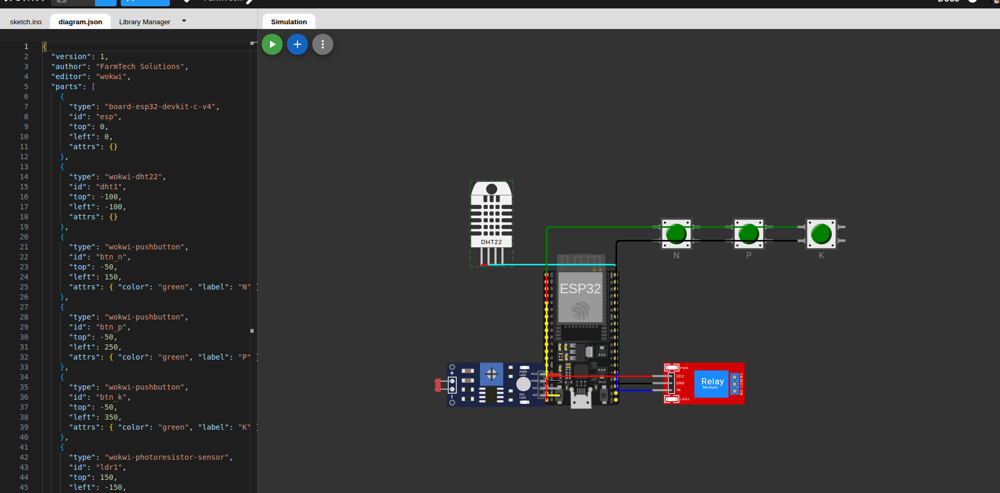

# Cap 1 - Um Mapa do Tesouro: Sistema de Irrigacao Inteligente e Fertirrigacao (FarmTech Solutions)

Projeto desenvolvido para a **FarmTech Solutions** como parte do ecossistema de Agricultura Digital (FIAP - Fase 2 - Capitulo 1).

---

## 1. Contexto e Fundamentacao Agronomica

Dando continuidade ao planejamento agricola iniciado na Fase 1, o sistema IoT da Fase 2 foi desenvolvido com foco prioritario na cultura do **Milho** (*Zea mays*), integrando monitoramento de solo, automacao de irrigacao e aplicacao balanceada de nutrientes baseada em pesquisas tecnicas da **Embrapa Milho e Sorgo**.

### Parametros Agronomicos Adotados:
- **Umidade do Solo (Capacidade de Campo e Estresse Hidrico):**
  - O milho possui alta demanda de agua, principalmente nas fases de florescimento e enchimento de graos.
  - **Nivel Critico (< 40%):** A taxa fotossintetica e comprometida, exigindo acionamento imediato da irrigacao (Bomba / Rele Azul ligado).
  - **Nivel Adequado (>= 60%):** O solo atinge a capacidade de campo desejada. A irrigacao e desligada para prevenir lixiviacao de nutrientes e asfixia do sistema radicular.
- **Macronutrientes (NPK - Nitrogenio, Fosforo e Potassio):**
  - **Nitrogenio (N):** Essencial para a formacao de biomassa, desenvolvimento foliar e teor de proteinas.
  - **Fosforo (P):** Fundamental para o enraizamento profundo inicial e floracao.
  - **Potassio (K):** Controla o fechamento estomatico, a turgidez celular e confere resistencia ao estresse termico e hidrico.
  - **Logica de Fertirrigacao:** Se o solo necessita de agua (umidade < 40%) e qualquer um dos macronutrientes estiver em nivel deficitario, o sistema aciona automaticamente o modo de **FERTIRRIGACAO**, aplicando calda hidrossoluvel de reposicao nutricional.
- **Acidez e pH do Solo:**
  - A faixa ideal de pH para cultivo do milho situa-se entre **5.5 e 6.8** (sendo 6.0 a 6.5 a faixa de maxima absorcao).
  - Solos com pH inferior a 6.0 sofrem toxidez por aluminio e reduzem drasticamente a absorcao de fosforo. Solos alcalinos (pH > 7.0) bloqueiam micronutrientes como zinco e ferro. O sistema emite alerta para intervencao e calagem.

---

## 2. Circuito IoT no Simulador Wokwi

Como a plataforma Wokwi.com nao possui sensores agropecuarios dedicados, foram empregadas simulacoes e analogias didaticas recomendadas pelas diretrizes do projeto:

| Sensor Real Simulado | Componente no Wokwi | Pino no ESP32 | Finalidade no Sistema |
| :--- | :--- | :--- | :--- |
| **Umidade do Solo** | Sensor DHT22 (`dht1`) | Pino 15 (SDA) | Monitora a umidade percentual do solo (0% a 100%) |
| **Nutriente Nitrogenio (N)** | Pushbutton Verde (`btn_n`) | Pino 12 (`INPUT_PULLUP`) | Nivel de N disponivel (Pressionado = Adequado / Solto = Deficitario) |
| **Nutriente Fosforo (P)** | Pushbutton Verde (`btn_p`) | Pino 14 (`INPUT_PULLUP`) | Nivel de P disponivel (Pressionado = Adequado / Solto = Deficitario) |
| **Nutriente Potassio (K)** | Pushbutton Verde (`btn_k`) | Pino 27 (`INPUT_PULLUP`) | Nivel de K disponivel (Pressionado = Adequado / Solto = Deficitario) |
| **Sensor de pH da Terra** | Sensor LDR Fotoresistor (`ldr1`) | Pino 34 (Analogico AO) | Mapeado proporcionalmente de 0 a 4095 para pH de 0 a 14 |
| **Bomba d'Agua** | Modulo Rele Azul (`relay1`) | Pino 2 (Digital OUT) | Controla o acionamento do fluxo hidrico e fertirrigacao |

---

## 3. Estrutura de Arquivos

```
CAP1-UM-MAPA-DO-TESOURO/
├── src/
│   ├── iot_esp32/
│   │   ├── diagram.json               # Diagrama e conexoes eletricas no Wokwi
│   │   └── sketch.ino                 # Codigo-fonte em C/C++ do firmware ESP32
│   ├── api_clima/
│   │   └── clima_api.py               # Integracao com a API Open-Meteo (Ir Alem 1)
│   └── data_analysis_r/
│       └── analise_irrigacao.R        # Estatistica descritiva e predicao (Ir Alem 2)
├── docs/
│   ├── circuito_wokwi.png             # Print do diagrama montado no Wokwi
│   └── roteiro_video.md               # Roteiro passo a passo do video demonstrativo
├── link_video.txt                     # URL do video nao listado no YouTube
└── README.md                          # Documentacao completa do Capitulo 1
```

---

## 4. Como Executar as Solucoes

### 4.1 Simulador Wokwi (Firmware ESP32)
1. Acesse o projeto no [Wokwi](https://wokwi.com) ou abra os arquivos `src/iot_esp32/diagram.json` e `src/iot_esp32/sketch.ino`.
2. Clique no botao de reproducao (Play).
3. No Monitor Serial (115200 baud), observe as telemetrias impressas a cada ciclo.
4. **Testes Interativos no Wokwi:**
   - Altere a umidade no DHT22 para menos de 40%: o Rele liga.
   - Solte algum dos botoes NPK: o monitor serial acusa 'INICIANDO FERTIRRIGACAO'.
   - Pressione os 3 botoes NPK (`Ctrl + Clique` no Wokwi): o monitor serial muda para 'INICIANDO IRRIGACAO COMUM (Apenas Agua)'.
   - Ajuste o LDR para alterar o pH: se sair da faixa 6.0 a 7.0, um alerta de calagem e exibido.

### 4.2 Programa Ir Alem 1: Integracao Python com API Publica
Script que consulta a probabilidade de precipitacao para as proximas 12 horas atraves da API Open-Meteo:
```bash
python3 src/api_clima/clima_api.py
```
- Se a probabilidade for alta (> 50%), o terminal instrui a digitar `1` no Monitor Serial do Wokwi, bloqueando o acionamento da bomba de forma preventiva para economia de agua.
- Se o tempo estiver firme, digitar `0` no Monitor Serial restabelece a operacao normal.

### 4.3 Programa Ir Alem 2: Data Science em R
Script estatistico que realiza a analise exploratoria dos dados dos ultimos 10 dias e calcula a media movel dos ultimos 3 dias (tendencia):
```bash
Rscript src/data_analysis_r/analise_irrigacao.R
```
- Saidas geradas: Media, Desvio Padrao, Minimo, Maximo e a prescricao automatica orientando ligar ou manter desligada a bomba d'agua.

---

## 5. Imagem do Circuito

O circuito completo montado e demonstrado no Wokwi pode ser visualizado abaixo:



---

## 6. Video Demonstrativo (Ate 5 minutos)

O video com o pitch da Startup FarmTech Solutions e a demonstracao funcional completa (Wokwi, Python e R) esta disponivel em:

- **Link no YouTube (Nao Listado):** [https://youtu.be/AVC19HA_oGU](https://youtu.be/AVC19HA_oGU) (tambem disponivel em [`link_video.txt`](./link_video.txt))
- **Roteiro Utilizado:** Consulte [`docs/roteiro_video.md`](./docs/roteiro_video.md)

