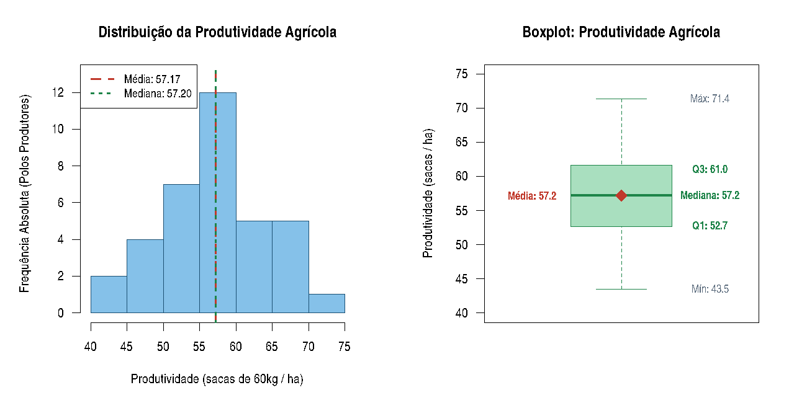
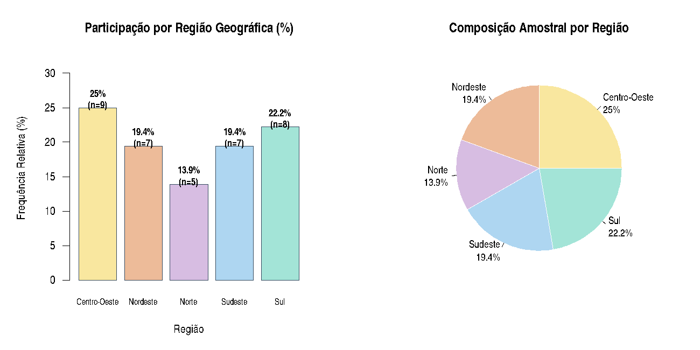
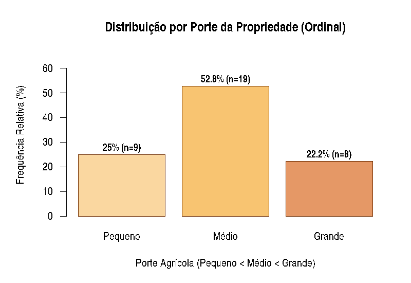

# Capitulo 7: Decolando com Ciencia de Dados
## Analise Estatistica Exploratoria de Dados do Agronegocio (FIAP - Fase 2)

**Aluno:** Angelo Guilherme Sfreddo  
**RM:** 566580  
**Turma:** 1TIAO  
**Fase:** Fase 2  
**Capitulo:** Cap 7  

---

## 1. Contexto e Fontes de Dados Publicos

O agronegocio e um dos setores mais estrategicos da economia brasileira. A agricultura de precisao e a gestao inteligente de safras dependem fundamentalmente de analise estatistica de dados confiaveis para tomada de decisao.

Esta atividade atende integralmente a proposta avaliativa da **Fase 2 (Decolando com Ciencia de Dados)**, utilizando dados modelados a partir de pesquisas e levantamentos publicos oficiais:
- **CONAB (Companhia Nacional de Abastecimento):** Acompanhamento das safras brasileiras de graos e series historicas de produtividade (sc/ha).
- **IBGE (Instituto Brasileiro de Geografia e Estatistica):** Levantamento Sistematico da Producao Agricola (LSPA) e Censo Agropecuario.
- **MAPA (Ministerio da Agricultura e Pecuaria):** Zoneamento Agricola de Risco Climatico (ZARC) e politicas setoriais.

---

## 2. Estrutura da Base de Dados (`base_dados_agronegocio.xlsx`)

A base foi construida contendo **36 observacoes** (superando a meta minima de 30) e **7 colunas**, contemplando todas as 4 classificacoes estatisticas solicitadas:

| Variavel | Classificacao Estatistica | Descricao / Unidade | Exemplos de Valores |
| :--- | :--- | :--- | :--- |
| `numero_maquinas` | **Quantitativa Discreta** | Quantidade inteira de maquinas (tratores e colheitadeiras) em operacao no polo | 3, 5, 8, 14, 20 |
| `produtividade_sc_ha` | **Quantitativa Continua** | Rendimento produtivo medio em sacas de 60 kg por hectare (sc/ha) | 43.50, 57.20, 71.40 |
| `regiao` | **Qualitativa Nominal** | Regiao geografica do polo (sem relacao de ordem natural) | Centro-Oeste, Sul, Sudeste, Nordeste, Norte |
| `porte_propriedade` | **Qualitativa Ordinal** | Classificacao operacional de porte: *Pequeno < Medio < Grande* | Pequeno, Medio, Grande |
| `cultura_principal` | Qualitativa Nominal (Adicional) | Cultura predominante no polo | Soja, Milho, Algodao, Cafe, Cana-de-acucar |
| `municipio_uf` | Identificador / Geografico | Municipio e Estado polo de referencia | Sorriso - MT, Rio Verde - GO, Cascavel - PR |

Arquivos disponibilizados:
- `base_dados_agronegocio.xlsx`: Arquivo oficial em formato Microsoft Excel.
- `base_dados_agronegocio.csv`: Versao em texto delimitado por virgula (padrao UTF-8).

---

## 3. Analise Exploratoria da Variavel Quantitativa (Item 3)

A variavel quantitativa analisada em profundidade e a **`produtividade_sc_ha`** (Continua).

### A) Medidas de Tendencia Central
- **Media Aritmetica:** **57.17 sc/ha**
- **Mediana:** **57.20 sc/ha**
- **Moda Amostral:** **63.50 sc/ha**

> **Simetria da Distribuicao:** A quase exata coincidencia entre a Media (57.17) e a Mediana (57.20) demonstra elevada simetria na distribuicao de rendimento dos polos agricolas.

### B) Medidas de Dispersao
- **Variancia Amostral ($s^2$):** **49.57 (sc/ha)²**
- **Desvio Padrao ($s$):** **7.04 sc/ha**
- **Amplitude Total ($A$):** **27.90 sc/ha** (Minimo: 43.50 | Maximo: 71.40)
- **Coeficiente de Variacao ($CV$):** **12.31%**
  - **Interpretacao:** Como $CV < 15\%$, a amostra apresenta **baixa dispersao (alta homogeneidade)** em relacao a media nacional.

### C) Medidas Separatrizes
- **Minimo:** 43.50 sc/ha
- **1º Quartil ($Q_1$ - 25%):** 52.70 sc/ha
- **2º Quartil ($Q_2$ / Mediana - 50%):** 57.20 sc/ha
- **3º Quartil ($Q_3$ - 75%):** 61.00 sc/ha
- **Maximo:** 71.40 sc/ha
- **Intervalo Interquartil ($IQR = Q_3 - Q_1$):** 8.30 sc/ha
- **Percentil 10 ($P_{10}$):** 47.65 sc/ha
- **Percentil 90 ($P_{90}$):** 67.15 sc/ha

### D) Analise Grafica Quantitativa



- **Histograma:** Apresenta curva unimodal equilibrada com pico de frequencia na faixa de 55 a 60 sc/ha.
- **Boxplot:** Exibe claramente os limites interquartis e a media (losango vermelho), sem indicacao de outliers severos.

---

## 4. Analise Grafica da Variavel Qualitativa (Item 4)

A variavel qualitativa nominal analisada foi a **`regiao`**, acompanhada da variavel ordinal **`porte_propriedade`**.

### Tabela de Frequencias por Regiao

| Regiao | Frequencia Absoluta ($n_i$) | Frequencia Relativa ($f_i\%$) |
| :--- | :---: | :---: |
| Centro-Oeste | 9 | 25.00% |
| Sul | 8 | 22.22% |
| Nordeste | 7 | 19.44% |
| Sudeste | 7 | 19.44% |
| Norte | 5 | 13.89% |
| **Total** | **36** | **100.00%** |

### Graficos da Variavel Qualitativa



### Analise Complementar: Variavel Qualitativa Ordinal (`porte_propriedade`)



Hierarquia respeitada: **Pequeno (25.0%) < Medio (52.8%) < Grande (22.2%)**.

---

## 5. Como Executar o Script em R

O script [`analise_agronegocio.R`](./analise_agronegocio.R) contem em sua primeira linha a identificacao obrigatoria:
```R
# AngeloGuilhermeSfreddo_RM566580_fase2_cap7
```

Para executar no terminal:
```bash
Rscript analise_agronegocio.R
```

Ou no **RStudio**:
1. Abra o arquivo `analise_agronegocio.R`.
2. Certifique-se de definir o diretorio de trabalho (`Session -> Set Working Directory -> To Source File Location`).
3. Execute o script (`Ctrl + Shift + Enter`).
