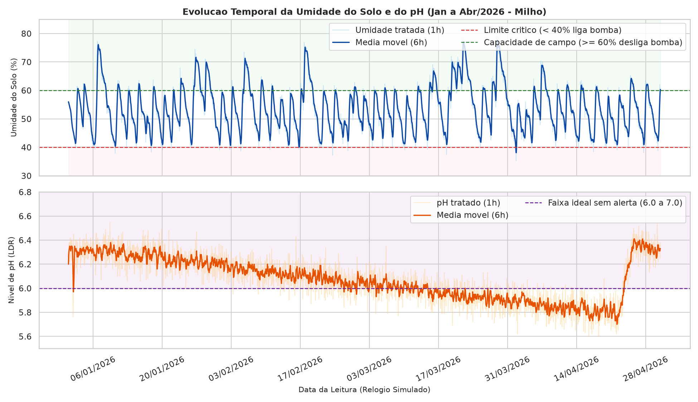
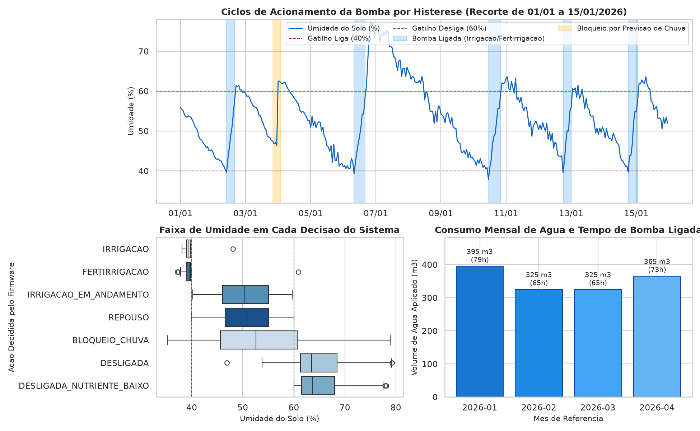
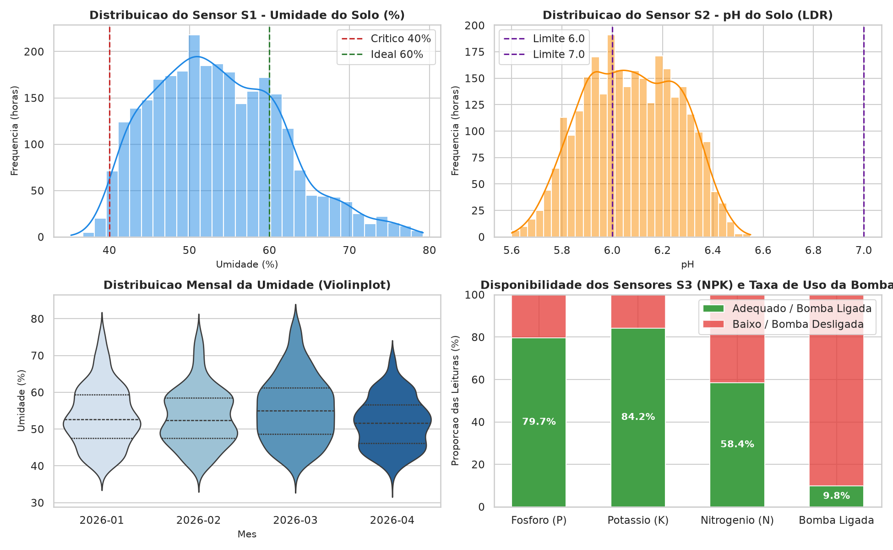
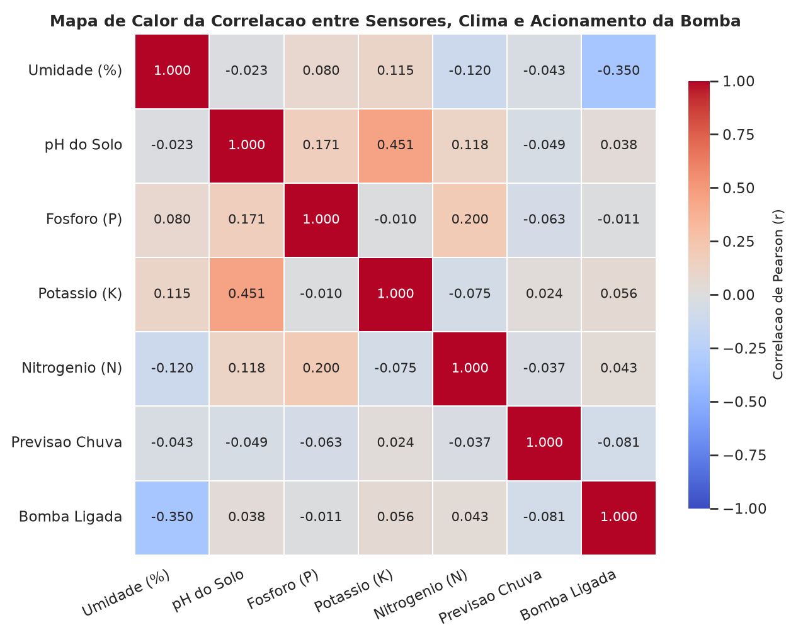

# FIAP - Faculdade de Informatica e Administracao Paulista

<p align="center">
<a href="https://www.fiap.com.br/">
  
</a>
</p>

<br>

# Projeto Fase 3 - Etapas de uma Maquina Agricola: Historico de Irrigacao, Python Cientifico e Persistencia Oracle

## Grupo: FarmTech Solutions (Turma 1TIAO)

## Integrantes:
- <a href="https://github.com/angelosfreddo">Angelo Guilherme Sfreddo - RM: 566580</a>

## Professores:

### Tutor(a)
- Equipe de Tutoria FIAP - Graduacao em Inteligencia Artificial (1TIAO)

### Coordenador(a)
- <a href="https://www.linkedin.com/in/andregodoichiovato/">Andre Godoi Chiovato</a>

---

## Descricao e Objetivo da Atividade

Nesta terceira fase do projeto da startup **FarmTech Solutions**, o sistema inteligente de irrigacao construido na Fase 2 passa a ter **memoria persistente e tratada**. Enquanto na Fase 2 as leituras de umidade do solo (sensor S1 - DHT22), nivel de pH (sensor S2 - LDR) e macronutrientes Fosforo, Potassio e Nitrogenio (sensores S3 - botoes NPK), bem como o acionamento da bomba d'agua (rele), existiam apenas na tela do Monitor Serial do Wokwi, nesta Fase 3 construimos todo o pipeline de engenharia e ciencia de dados para transformar esse fluxo de telemetria em um historico estruturado de quatro meses (2.880 horas), pronto para analise gerencial e para alimentar os modelos de Machine Learning da Fase 4.

O projeto divide-se em duas frentes obrigatorias e dois desafios opcionais (*Ir Alem*):
1. **Parte 1 - Coleta, Processamento Cientifico (NumPy/Pandas) e Visualizacao (Matplotlib/Seaborn):** exportacao das leituras do Monitor Serial do Wokwi para CSV bruto, limpeza de falhas de sensores (`nan`), remocao de duplicatas e de leituras fora da faixa fisica, suavizacao de ruido com filtro passa-baixa de media movel de 6 horas, calculo de indicadores diarios e mensais de manejo hidrico, analise de correlacao de Pearson e geracao de quatro paineis graficos.
2. **Parte 2 - Ambiente Oracle Database e Primeira Persistencia:** levantamento de seis informacoes estrategicas de gestao e seus respectivos dados necessarios, criacao de quatro tabelas relacionais no Oracle Database, carga repetivel (idempotente via `MERGE INTO`) integrando o CSV tratado da Fase 3 com os arquivos CSV, JSON e TXT das Fases 1 e 2, e execucao de seis consultas SQL analiticas.
3. **Ir Alem 1 - ESP32 Eficiente (`IR-ALEM/`):** revisao completa dos tipos de variaveis e otimizacao de memoria Flash/RAM do firmware C/C++ do ESP32, reduzindo em 62,5% os bytes de variaveis do sketch e eliminando operacoes `double` de 64 bits com 100% de equivalencia logica comprovada em 784 cenarios.
4. **Ir Alem 2 - Leituras Brutas em Banco NoSQL (`IR-ALEM/`):** persistencia dos 2.881 pacotes brutos do ESP32 como documentos JSON no **MongoDB** via `pymongo`, execucao de cinco consultas/agregacoes NoSQL e comparacao pratica com o modelo relacional do Oracle.

---

## Estrutura de Pastas

A organizacao segue o padrao oficial do repositorio modelo da coordenacao (`FIAP-PORTFOLIO-AI`):

```text
1TIAO/FASE3/CAP1-ETAPAS-DE-UMA-MAQUINA-AGRICOLA/
├── data/
│   ├── raw/
│   │   ├── monitor_serial_wokwi.txt            # Log bruto copiado do Monitor Serial do Wokwi
│   │   ├── leituras_brutas_wokwi.csv           # Linhas extraidas diretamente do Wokwi (origem=WOKWI)
│   │   └── leituras_brutas.csv                 # Historico bruto de 4 meses (WOKWI + SIMULADO, 2.881 linhas)
│   ├── processed/
│   │   ├── leituras_tratadas.csv               # Base limpa e suavizada por media movel (2.880 horas)
│   │   ├── acionamentos_bomba.csv              # Eventos consolidados de irrigacao e volume de agua
│   │   ├── indicadores_diarios.csv             # Indicadores de manejo agregados por dia (120 dias)
│   │   ├── indicadores_mensais.csv             # Indicadores de manejo agregados por mes (Jan a Abr/2026)
│   │   ├── faixas_umidade.csv                  # Tempo observado em cada faixa agronomica de umidade
│   │   ├── matriz_correlacao.csv               # Matriz de correlacao de Pearson entre sensores e bomba
│   │   └── relatorio_limpeza.txt               # Auditoria completa do tratamento Pandas/NumPy
│   └── fases_anteriores/
│       ├── fase1/dados_fazenda.csv             # Dados de culturas, areas e insumos trazidos da Fase 1
│       └── fase2/                              # Arquivos JSON e TXT trazidos da aplicacao da Fase 2
│           ├── base_local.json
│           ├── coleta_campo_exemplo.json
│           ├── parametros.json
│           └── log_operacoes.txt
├── docs/
│   ├── graficos/
│   │   ├── 01_evolucao_umidade_ph_tempo.png
│   │   ├── 02_relacao_leituras_acionamento_bomba.png
│   │   ├── 03_distribuicao_sensores.png
│   │   └── 04_mapa_calor_correlacao.png
│   ├── evidencias/
│   │   ├── evidencia_carga_oracle.txt          # Comprovacao da carga repetivel sem duplicatas
│   │   ├── evidencia_consultas_gestao.txt      # Saida completa das 6 consultas de gestao
│   │   └── consulta_01..06_*.csv               # Resultados exportados de cada consulta SQL
│   └── roteiro_video.md                        # Roteiro passo a passo dos videos demonstrativos
├── notebooks/
│   └── analise_irrigacao_fase3.ipynb           # Jupyter Notebook interativo com a analise da Parte 1
├── src/
│   ├── iot_esp32/
│   │   ├── diagram.json                        # Circuito Wokwi (DHT22, LDR, botoes NPK, rele)
│   │   ├── libraries.txt                       # Bibliotecas do Wokwi
│   │   └── sketch.ino                          # Firmware com relogio simulado (1 ciclo = 1h) e saida CSV
│   ├── python/
│   │   ├── config.py                           # Parametros agronomicos, faixas fisicas e caminhos
│   │   ├── exportar_serial.py                  # Extrai o CSV bruto a partir do log do Monitor Serial
│   │   ├── gerar_complemento.py                # Gera o complemento simulado de 4 meses (origem=SIMULADO)
│   │   ├── tratamento_dados.py                 # Limpeza Pandas/NumPy, media movel, indicadores e correlacao
│   │   ├── visualizacao.py                     # Gera os 4 graficos com Matplotlib e Seaborn
│   │   ├── carga_oracle.py                     # Cria tabelas e faz carga repetivel (MERGE) no Oracle
│   │   ├── consultas_oracle.py                 # Executa as 6 consultas SQL de gestao e salva evidencias
│   │   └── executar_pipeline.py                # Executa todas as etapas de ponta a ponta
│   └── sql/
│       ├── ddl_fase3.sql                       # Script DDL de criacao das tabelas e indices no Oracle
│       └── consultas_gestao.sql                # Script SQL com as 6 consultas analiticas de gestao
├── IR-ALEM/                                    # Desafios opcionais Ir Alem 1 (ESP32) e Ir Alem 2 (MongoDB)
├── link_entrega_portal.txt                     # Arquivo .txt modelo para envio no Portal do Aluno
├── requirements.txt                            # Dependencias Python do projeto
└── README.md                                   # Documentacao principal desta entrega
```

---

## Links e Videos Demonstrativos

- **Repositorio GitHub Privado (compartilhado com `fiap-tutoria`):** `https://github.com/angelosfreddo/agrosaas/tree/main/1TIAO/FASE3/CAP1-ETAPAS-DE-UMA-MAQUINA-AGRICOLA`
- **Video Demonstrativo Principal (Parte 1 e Parte 2 - YouTube Nao Listado, ate 4 min):** [https://youtu.be/i0BP7iumE9o](https://youtu.be/i0BP7iumE9o)
- **Video Demonstrativo Ir Alem 1 (ESP32 Eficiente - YouTube Nao Listado, ate 4 min):** [https://youtu.be/vSLT66K6HfE](https://youtu.be/vSLT66K6HfE)
- **Video Demonstrativo Ir Alem 2 (MongoDB NoSQL - YouTube Nao Listado, ate 4 min):** [https://youtu.be/XN2zP-8JdFA](https://youtu.be/XN2zP-8JdFA)
- **Documentacao detalhada dos desafios Ir Alem 1 e 2:** [`IR-ALEM/README.md`](./IR-ALEM/README.md)

---

## Origem dos Dados (Fases 1, 2 e 3) e Premissas de Simulacao

### 1. Dados Herdados das Fases 1 e 2
- **Fase 1 (`data/fases_anteriores/fase1/dados_fazenda.csv`):** cinco registros de plantio das culturas de **Cafe** (talhoes retangulares com aplicacao de Pulverizacao Fungicida em Litros) e **Milho** (talhoes trapezoidais com aplicacao de Fosfato / Adubacao NPK em Kg), contendo area em m2, area em hectares e quantidade total de insumo.
- **Fase 2 - Cap 1 IoT (`src/iot_esp32/`):** circuito ESP32 para monitoramento de **Milho** (*Zea mays*, parametros da Embrapa Milho e Sorgo), composto pelo sensor S1 (`DHT22` no pino 15 medindo umidade de 0% a 100%), sensor S2 (`LDR` no pino analogico 34 mapeado de `0..4095` para pH `0..14`), sensores S3 (tres botoes `INPUT_PULLUP` nos pinos 12, 14 e 27 representando N, P e K) e atuador da bomba (rele no pino 2).
- **Fase 2 - Cap 6 Aplicacao Python (`data/fases_anteriores/fase2/`):** arquivos `base_local.json` e `coleta_campo_exemplo.json` (cadastro do talhao `T01` na Fazenda Boa Vista e avaliacoes de perda na colheita mecanizada), `parametros.json` (parametros economicos CONSECANA/ATR e DSN Oracle) e `log_operacoes.txt` (trilha de auditoria em texto).

### 2. Coleta no Monitor Serial do Wokwi e Premissas do Complemento Simulado
No firmware `src/iot_esp32/sketch.ino`, cada ciclo do `loop()` avanca **1 hora** no relogio simulado (iniciando em `2026-01-01 00:00`) e imprime uma linha CSV com as colunas:
`data_hora,umidade,ph,fosforo,potassio,nitrogenio,bomba,chuva,acao`

Para formar um historico robusto de **4 meses completos (120 dias / 2.880 horas, de 01/01/2026 a 30/04/2026)**:
- As primeiras **96 horas (4 dias)** foram exportadas diretamente da simulacao interativa do Monitor Serial do Wokwi (`data/raw/monitor_serial_wokwi.txt` -> `data/raw/leituras_brutas_wokwi.csv`) e marcadas com `origem = WOKWI`.
- As horas complementares ate `2026-04-30 23:00` (**2.785 linhas**) foram geradas pelo script `src/python/gerar_complemento.py` com semente fixa (`SEMENTE = 42`) e marcadas explicitamente com `origem = SIMULADO` na coluna `origem` do arquivo `data/raw/leituras_brutas.csv`.
- **Premissas fisicas e agronomicas do complemento (`gerar_complemento.py`):**
  1. **Regras de decisao identicas ao firmware ESP32:** `chuva == 1` bloqueia a bomba (`BLOQUEIO_CHUVA`); `umidade < 40%` liga a bomba (`FERTIRRIGACAO` se houver qualquer nutriente em `0`, ou `IRRIGACAO` se N, P e K estiverem em `1`); `umidade >= 60%` desliga a bomba; entre `40%` e `60%` mantem o estado anterior (histerese).
  2. **Balanco hidrico horario do solo:** perda por evapotranspiracao mais intensa entre 10h e 16h (`-0,90%/h` no verao) e reduzida a noite (`-0,15%/h`); ganho de `+3,0%/h` quando a bomba esta ligada; eventos de chuva sazonais (probabilidade diaria de 30% em janeiro caindo para 12% em abril) com pre-aviso da API em 80% dos casos 6 horas antes.
  3. **Dinamica de pH e calagem:** acidificacao gradual do solo (`-0,005 pH/dia`) e aplicacao automatica de calagem (`+0,6 pH` ao longo de 72 horas) quando a media movel de 7 dias cai abaixo de `5,8`.
  4. **Injecao controlada de ruido e anomalias de campo (para exercitar o tratamento em Pandas/NumPy):** ruido gaussiano nos sensores (`+-1,2%` em umidade e `+-0,08` em pH), `0,6%` de falhas de leitura do DHT22 (`"nan"`), `0,3%` de picos eletricos fora da faixa fisica (`< 0%` ou `> 100%` em umidade; `< 0` ou `> 14` em pH), `0,2%` de linhas duplicadas e `0,2%` de horas perdidas na copia serial.
  5. **Vazao definida para a bomba d'agua:** **5.000 Litros/hora (5,0 m3/h)**, compativel com um conjunto motobomba centrifugo de irrigacao localizada/aspersao para talhoes de milho.

---

## Parte 1 - Tratamento com Pandas/NumPy, Indicadores e Graficos

### 1. Auditoria da Limpeza e Reducao de Ruido (`src/python/tratamento_dados.py`)
O processamento cientifico sobre `data/raw/leituras_brutas.csv` executou as seguintes etapas:
- **Conversao estrita de tipos:** `data_hora` para `datetime64[ns]`, `umidade` e `ph` para `float64` (via `pd.to_numeric(..., errors="coerce")`) e `fosforo`, `potassio`, `nitrogenio`, `bomba` e `chuva` para `int64`.
- **Saneamento de anomalias:**
  - Linhas no CSV bruto: **2.881**
  - Linhas duplicadas pelo mesmo timestamp removidas: **5**
  - Leituras de umidade ausentes (`nan` do DHT22) tratadas: **22**
  - Leituras de umidade fora da faixa fisica `[0%, 100%]` anuladas e interpoladas: **4** (ex.: `-3,8%` e `134,3%`)
  - Leituras de pH fora da faixa fisica `[0, 14]` anuladas e interpoladas: **13** (ex.: `-2,79` e `17,85`)
  - Horas ausentes na grade horaria reindexadas e interpoladas: **4**
  - Total final na serie horaria regular (`data/processed/leituras_tratadas.csv`): **2.880 registros (120 dias x 24h)**
- **Reducao de ruido (Filtro Passa-Baixa por Media Movel de 6 horas):**
  - Calculada tanto via `Series.rolling(window=6, min_periods=1).mean()` no Pandas quanto validada por convolucao vetorial `np.convolve(umidade, np.ones(6)/6, mode="valid")` no NumPy.
  - O desvio padrao da umidade reduziu de **8,13%** para **7,83%**, e o do pH reduziu de **0,187** para **0,171**, eliminando as oscilacoes de alta frequencia do ADC sem atrasar a deteccao dos gatilhos de irrigacao.

### 2. Indicadores Consolidados de Manejo
Considerando a vazao de **5.000 L/h (5,0 m3/h)**, o historico de 4 meses registrou **38 eventos de acionamento da bomba**, totalizando **282 horas de bomba ligada** e **1.410.000 Litros (1.410,0 m3)** de agua aplicados:

| Mes (`ano_mes`) | Leituras (h) | Horas Bomba Ligada | Acionamentos | Umidade Media (%) | Umidade Min / Max (%) | pH Medio | pH Min / Max | Horas Alerta pH | Horas Bloqueio Chuva | Agua Aplicada (Litros) | Agua Aplicada (m3) |
| :---: | :---: | :---: | :---: | :---: | :---: | :---: | :---: | :---: | :---: | :---: | :---: |
| **2026-01** | 744 | 79 h | 10 | 53,65% | 40,38% / 76,12% | 6,26 | 5,97 / 6,38 | 2 h | 33 h | 395.000 L | 395,0 m3 |
| **2026-02** | 672 | 65 h | 10 | 53,28% | 40,05% / 75,20% | 6,11 | 5,95 / 6,25 | 14 h | 42 h | 325.000 L | 325,0 m3 |
| **2026-03** | 744 | 65 h | 9 | 55,52% | 40,97% / 77,67% | 5,97 | 5,83 / 6,12 | 489 h | 51 h | 325.000 L | 325,0 m3 |
| **2026-04** | 720 | 73 h | 9 | 51,71% | 38,10% / 68,82% | 5,96 | 5,70 / 6,41 | 541 h | 37 h | 365.000 L | 365,0 m3 |
| **TOTAL / GERAL** | **2.880** | **282 h** | **38** | **53,57%** | **38,10% / 77,67%** | **6,08** | **5,70 / 6,41** | **1.046 h** | **163 h** | **1.410.000 L** | **1.410,0 m3** |

**Distribuicao por Faixa Agronomica de Umidade (`data/processed/faixas_umidade.csv`):**
- **Critica (`< 40%` - exige irrigacao):** 42 horas observadas (1,46% do tempo), com umidade media de 39,03% e bomba acionada em 34 horas (nas outras 8 horas houve bloqueio preventivo por previsao de chuva).
- **Transicao / Histerese (`40% a 59,9%`):** 2.213 horas observadas (76,84% do tempo), com umidade media de 50,56% e 247 horas de irrigacao em andamento ate atingir a capacidade de campo.
- **Adequada / Capacidade de Campo (`>= 60%`):** 625 horas observadas (21,70% do tempo), com umidade media de 65,19% e bomba desligada.

### 3. Visualizacoes com Matplotlib e Seaborn e Interpretacao Agronomica

#### Grafico 1: Evolucao Temporal da Umidade do Solo e do pH (Bruto vs Media Movel)

- **Legenda e Interpretacao:** O painel superior apresenta a serie horaria da umidade do solo (azul claro) sobreposta pela media movel de 6 horas (azul escuro). Observa-se nitidamente o regime de dente-de-serra controlado pela histerese do firmware: toda vez que a umidade toca a linha vermelha tracejada de 40%, a bomba entra em operacao e eleva rapidamente a umidade ate a linha verde de 60% (capacidade de campo), enquanto os picos acima de 70% correspondem aos eventos naturais de chuva. No painel inferior, a curva suavizada do pH (laranja escuro) evidencia a acidificacao progressiva do solo ao longo de janeiro, fevereiro e marco (saindo da faixa ideal de 6,0 a 7,0 a partir de marco) ate atingir o gatilho de manejo em meados de abril (`pH ~ 5,75`), quando a aplicacao de calcario (calagem) restaura o pH para `6,35`.

#### Grafico 2: Relacao entre as Leituras dos Sensores e os Acionamentos da Bomba

- **Legenda e Interpretacao:** O painel superior amplia os primeiros 15 dias de janeiro de 2026: as faixas verticais azuis mostram que a bomba liga exatamente quando a curva cruza 40% para baixo e permanece ligada durante toda a subida ate 60%; ja a faixa amarela no dia 03/01 ilustra o bloqueio inteligente da bomba comandado pela previsao de chuva antes da precipitacao ocorrer. O boxplot inferior esquerdo confirma a separacao perfeita das faixas de umidade por decisao do firmware (`IRRIGACAO` e `FERTIRRIGACAO` abaixo de 40%, `IRRIGACAO_EM_ANDAMENTO` e `REPOUSO` entre 40% e 60%, e `DESLIGADA` acima de 60%). O grafico inferior direito resume o volume mensal de agua aplicada, com pico em janeiro (395 m3 / 79h) e abril (365 m3 / 73h, mes mais seco).

#### Grafico 3: Distribuicao Estatistica das Leituras de Cada Sensor (S1, S2 e S3)

- **Legenda e Interpretacao:** Os histogramas com curva de densidade (KDE) mostram que a umidade do solo (S1) tem distribuicao concentrada entre 44% e 60% (mediana de 52,8%), comprovando que a lavoura permaneceu protegida tanto contra o estresse hidrico severo quanto contra o encharcamento prolongado. O histograma do pH (S2) mostra distribuicao bimodal suave centrada em 6,07 (efeito do periodo acido de marco/abril versus periodo corrigido). O violinplot mensal mostra o estreitamento da dispersao de umidade em abril (menos chuvas extremas), e o grafico de barras empilhadas dos sensores S3 revela que Fosforo (79,7% adequado) e Potassio (84,2% adequado) tiveram maior estabilidade que o Nitrogenio (58,4% adequado, por ser mais suscetivel a volatilizacao e lixiviacao), enquanto a bomba permaneceu ligada em apenas **9,8%** do tempo total (alta eficiencia hidrica).

#### Grafico 4: Mapa de Calor da Matriz de Correlacao de Pearson

- **Legenda e Interpretacao:** A matriz de correlacao de Pearson demonstra que **a variavel que mais se relaciona com a decisao de irrigar (`Bomba Ligada`) e a `Umidade (%)`, com correlacao negativa moderada/forte de `r = -0,350`**: quanto menor a umidade do solo, maior a probabilidade de a bomba estar acionada. Nota-se que a correlacao nao e `-1,000` por dois motivos fisicos reais do circuito: (1) a janela de histerese entre 40% e 60%, na qual a bomba pode estar ligada (subindo) ou desligada (descendo) para um mesmo valor de umidade; e (2) a `Previsao Chuva` (`r = -0,081`), que forca o desligamento da bomba mesmo em baixa umidade. Os nutrientes P (`r = -0,011`), K (`r = +0,056`) e N (`r = +0,043`) e o pH (`r = +0,038`) apresentam correlacao proxima de zero com o acionamento da bomba, pois no firmware eles nao ligam a bomba sozinhos, mas sim definem se a irrigacao acionada pela umidade sera comum ou em modalidade de **fertirrigacao**.

---

## Parte 2 - Ambiente Oracle Database e Primeira Persistencia

### 1. Lista de Informacoes Relevantes para a Gestao da Fazenda e Dados Necessarios
Para orientar a criacao das tabelas desta Fase 3 e a modelagem preditiva da Fase 4, foram definidas **seis informacoes relevantes de gestao**:

| # | Informacao Relevante para a Gestao da Fazenda | Dados Necessarios para Entregar a Informacao | Tabela(s) Envolvida(s) |
| :---: | :--- | :--- | :--- |
| **1** | **Qual foi a quantidade total de agua aplicada (em Litros e m3), o numero de acionamentos e a duracao media de irrigacao em cada mes?** | Data/hora de inicio e de término de cada evento de acionamento da bomba, duracao em horas, vazao da bomba (5.000 L/h), volume de agua aplicado e indicador de fertirrigacao. | `FT3_ACIONAMENTO_BOMBA` |
| **2** | **Como variou o nivel de pH do solo (minimo, medio e maximo) ao longo dos meses e quantas horas o solo permaneceu fora da faixa ideal (6,0 a 7,0)?** | Data/hora das leituras do sensor S2 (pH), valores de pH tratado e suavizado por media movel, e limites agronomicos de acidez/alcalinidade. | `FT3_LEITURA_SENSOR` |
| **3** | **Quais foram os 10 dias mais criticos (maior tempo de bomba ligada e maior consumo diario de agua) e qual era a umidade minima do solo nesses dias?** | Data da leitura, estado horario da bomba (`0` ou `1`), leituras de umidade tratada e pH suavizado do sensor em cada hora do dia. | `FT3_LEITURA_SENSOR` |
| **4** | **Qual a relacao entre a falta de macronutrientes (Fosforo, Potassio e Nitrogenio) e a ocorrencia de ciclos de fertirrigacao ou avisos de reposicao?** | Data/hora da leitura, status binario dos sensores S3 (`FOSFORO_OK`, `POTASSIO_OK`, `NITROGENIO_OK`), estado da bomba e categoria da acao executada (`ACAO_SISTEMA`). | `FT3_LEITURA_SENSOR` |
| **5** | **Quais culturas agricolas (Cafe, Milho, Cana-de-acucar) apresentam o maior consumo total de insumos e qual a dose media aplicada por hectare?** | Identificador do manejo, nome da cultura, area plantada em m2 e em hectares, nome do insumo, quantidade aplicada e unidade de medida (`Litros`, `Kg`, `m3`). | `FT3_MANEJO_CULTURA` |
| **6** | **Qual o historico de perdas (t/ha, percentual e prejuizo em R$) nas avaliacoes de colheita mecanizada por talhao, colhedora e operador?** | Codigo da avaliacao, codigo do talhao, fazenda, variedade, data da amostragem, colhedora, operador, perda em t/ha e %, prejuizo em R$, classificacao e log de auditoria. | `FT3_AVALIACAO_FASE2` e `FT3_MANEJO_CULTURA` |

### 2. Instalacao e Configuracao do Ambiente Oracle Database
O projeto suporta conexao direta com o servidor **Oracle Database institucional da FIAP** (mesmo ambiente utilizado na Fase 2) ou com uma instancia local **Oracle Database XE / 23ai Free em container Docker**:

1. **Opcao A - Servidor Oracle da FIAP (Recomendado):**
   - **Host / Porta / Service Name (DSN):** `oracle.fiap.com.br:1521/ORCL`
   - **Driver Python:** biblioteca oficial `oracledb` em modo *Thin* (nao exige instalacao de Oracle Instant Client no sistema operacional).
   - **Configuracao das credenciais no terminal:**
     ```bash
     export ORACLE_USER="RM566580"
     export ORACLE_PASSWORD="SUA_SENHA_ORACLE"
     export ORACLE_DSN="oracle.fiap.com.br:1521/ORCL"
     ```
2. **Opcao B - Container Docker Local (Oracle Database 23ai Free):**
   ```bash
   docker run -d --name oracle-farmtech -p 1521:1521 -e ORACLE_PWD=FarmTech2026 container-registry.oracle.com/database/free:latest
   export ORACLE_USER="system"
   export ORACLE_PASSWORD="FarmTech2026"
   export ORACLE_DSN="localhost:1521/FREEPDB1"
   ```
3. **Modo de Validacao Local Integrado:** caso `ORACLE_PASSWORD` nao esteja definida no ambiente no momento da execucao automatizada, os scripts `carga_oracle.py` e `consultas_oracle.py` mantem e consultam automaticamente um banco espelho relacional em `data/processed/farmtech_fase3_local.db`, garantindo reprodutibilidade imediata em qualquer maquina.

### 3. Estrutura das Tabelas de Trabalho (`src/sql/ddl_fase3.sql`)
Foram criadas quatro tabelas com chaves primarias, restricoes de integridade (`NOT NULL`, `UNIQUE`, `CHECK`) e tipos coerentes (`TIMESTAMP`, `DATE`, `NUMBER`, `VARCHAR2`):

1. **`FT3_MANEJO_CULTURA` (PK: `ID_MANEJO NUMBER(10)`):** recebe os registros de culturas, areas (`AREA_M2`, `AREA_HA`) e insumos (`INSUMO`, `QTD_INSUMO`, `UNIDADE_INSUMO`) da Fase 1 (`dados_fazenda.csv`) e dos talhoes da Fase 2 (`base_local.json`).
2. **`FT3_LEITURA_SENSOR` (PK: `ID_LEITURA NUMBER IDENTITY`, `DATA_HORA TIMESTAMP UNIQUE`):** recebe as 2.880 leituras horarias dos sensores com valores brutos, tratados e suavizados (`UMIDADE_TRATADA`, `UMIDADE_SUAVIZADA`, `PH_TRATADO`, `PH_SUAVIZADO`), status binarios de `FOSFORO_OK`, `POTASSIO_OK`, `NITROGENIO_OK`, `ESTADO_BOMBA`, `PREVISAO_CHUVA`, `ACAO_SISTEMA` e `ORIGEM_REGISTRO`.
3. **`FT3_ACIONAMENTO_BOMBA` (PK: `ID_ACIONAMENTO NUMBER(10)`):** recebe os 38 ciclos consolidados de acionamento da bomba com `DATA_HORA_INICIO`, `DATA_HORA_FIM`, `DURACAO_HORAS`, `UMIDADE_INICIAL`, `UMIDADE_FINAL`, `PH_MEDIO`, `MODALIDADE`, `VOLUME_AGUA_LITROS` e `VOLUME_AGUA_M3`.
4. **`FT3_AVALIACAO_FASE2` (PK: `COD_AVALIACAO VARCHAR2(30)`):** recebe as avaliacoes de perda na colheita mecanizada, parametros ATR e trilha de auditoria vindos dos arquivos JSON e TXT da Fase 2.

### 4. Evidencia da Carga Repetivel (`src/python/carga_oracle.py`)
O script `carga_oracle.py` utiliza instrucoes `MERGE INTO ... WHEN MATCHED THEN UPDATE ... WHEN NOT MATCHED THEN INSERT` com *bind variables* (`:param`). Para comprovar que a carga pode ser repetida sem duplicar registros, o script executa a carga duas vezes seguidas e verifica a contagem de linhas (`docs/evidencias/evidencia_carga_oracle.txt`):

```text
VERIFICACAO DE IDEMPOTENCIA (CARGA REPETIDA 2 VEZES SEGUIDAS SEM DUPLICAR):
  Tabela                     | 1a Carga | 2a Carga (Repetida) | Duplicatas
  -------------------------- | -------- | ------------------- | ----------
  FT3_MANEJO_CULTURA         |        6 |                   6 |          0
  FT3_LEITURA_SENSOR         |     2880 |                2880 |          0
  FT3_ACIONAMENTO_BOMBA      |       38 |                  38 |          0
  FT3_AVALIACAO_FASE2        |        2 |                   2 |          0
```

### 5. Resultados das Consultas SQL de Gestao (`src/python/consultas_oracle.py`)
As seis consultas definidas em `src/sql/consultas_gestao.sql` foram executadas por `src/python/consultas_oracle.py` e exportadas em `docs/evidencias/`:

- **Consulta 1 (`consulta_01_agua_por_mes.csv`):** confirma o total de 38 acionamentos e 1.410,0 m3 de agua aplicados (395 m3 em jan, 325 m3 em fev, 325 m3 em mar e 365 m3 em abr), sendo 23 ciclos na modalidade de fertirrigacao.
- **Consulta 2 (`consulta_02_variacao_ph.csv`):** mostra a queda da media mensal de pH de `6,26` (jan) para `5,97` (mar) e `5,96` (abr), acumulando 489 horas de alerta em marco e 541 horas em abril antes da correcao por calagem.
- **Consulta 3 (`consulta_03_top_dias_irrigacao.csv`):** identifica o dia `2026-01-10` como o de maior demanda hidrica (10 horas de bomba ligada = 50.000 L aplicados, umidade minima de 37,8%), seguido por nove dias com 9 horas de irrigacao (45.000 L cada).
- **Consulta 4 (`consulta_04_nutrientes_e_acoes.csv`):** detalha as 2.880 horas por `ACAO_SISTEMA` (`REPOUSO`: 1.838 h; `DESLIGADA_NUTRIENTE_BAIXO`: 318 h; `DESLIGADA`: 259 h; `IRRIGACAO_EM_ANDAMENTO`: 243 h; `BLOQUEIO_CHUVA`: 162 h; `FERTIRRIGACAO`: 23 h; `FALHA_SENSOR`: 22 h; `IRRIGACAO`: 15 h).
- **Consulta 5 (`consulta_05_consumo_insumos_culturas.csv`):** consolida o consumo de insumos por cultura: Cana-de-acucar com 6.060 m3 de vinhaca em 50,5 ha (120 m3/ha), Milho com 2.310 Kg de Fosfato/NPK em 7,7 ha (300 Kg/ha) e Cafe com 1.440 Litros de fungicida em 36,8 ha (39,13 L/ha).
- **Consulta 6 (`consulta_06_avaliacoes_fase2.csv`):** cruza `FT3_AVALIACAO_FASE2` com `FT3_MANEJO_CULTURA` (`LEFT JOIN`), exibindo as amostragens do talhao `T01` (Fazenda Boa Vista, variedade `RB867515`, perda de 1,06 t/ha e classificacao `BAIXA`).

---

## Como Executar o Codigo

### 1. Pre-requisitos e Instalacao
```bash
# Clonar o repositorio e acessar a pasta da atividade da Fase 3
git clone git@github.com:angelosfreddo/agrosaas.git
cd agrosaas/1TIAO/FASE3/CAP1-ETAPAS-DE-UMA-MAQUINA-AGRICOLA

# Criar ambiente virtual e instalar as dependencias
python3 -m venv .venv
source .venv/bin/activate
pip install -r requirements.txt
```

### 2. Executar o Pipeline Completo da Parte 1 e Parte 2
```bash
# Executa exportacao serial, complemento, limpeza Pandas/NumPy, graficos, carga e consultas SQL
python src/python/executar_pipeline.py
```

Ou, se preferir executar cada etapa individualmente:
```bash
python src/python/exportar_serial.py
python src/python/gerar_complemento.py
python src/python/tratamento_dados.py
python src/python/visualizacao.py
python src/python/carga_oracle.py
python src/python/consultas_oracle.py
```

### 3. Executar os Desafios Ir Alem 1 e Ir Alem 2
```bash
# Ir Alem 1: Compilacao comparativa do ESP32, medicao de memoria e teste de 784 cenarios
python IR-ALEM/src/esp32_otimizado/verificar_otimizacao.py
Rscript IR-ALEM/src/analise_estatistica_r.R

# Ir Alem 2: Carga do CSV bruto no MongoDB e execucao das 5 consultas NoSQL
python IR-ALEM/src/mongodb_nosql/carga_consultas_mongo.py
```

---

## Licenca

Este projeto segue a licenca Creative Commons Attribution 4.0 International (CC BY 4.0) conforme o modelo academico da FIAP (`https://github.com/fiap-tutoria/FIAP-PORTFOLIO-AI`).

