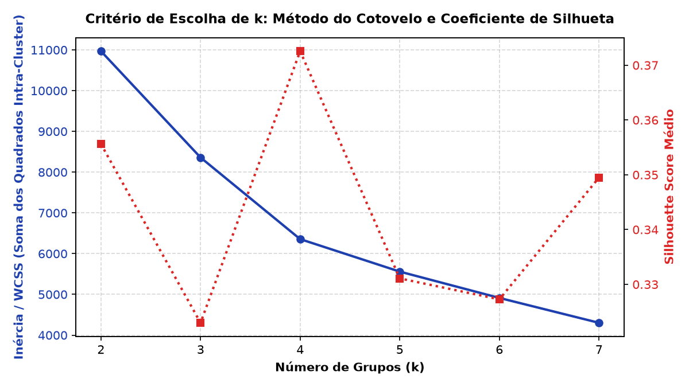
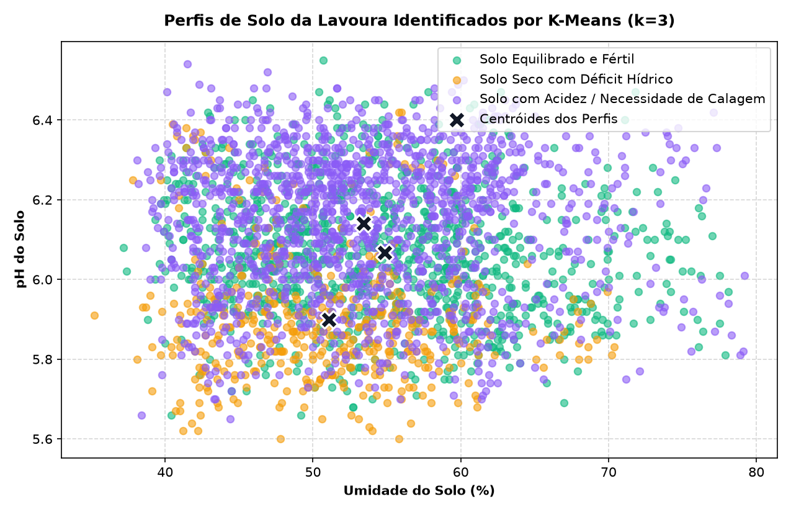

# Ir Além 2 — Perfis de Solo por Clusterização (K-Means)

**Projeto:** FarmTech Solutions — Safra do Conhecimento Cibernético (Fase 4)  
**Aluno:** Angelo Guilherme Sfreddo (RM: 566580) — Turma: 1TIAO  

---

## 1. Objetivo
Descobrir padrões e perfis recorrentes nas condições de solo da fazenda utilizando Aprendizado Não Supervisionado (**K-Means**) sobre as 2.880 leituras históricas dos sensores, traduzindo os agrupamentos matemáticos em recomendações agronômicas de manejo e exibindo-os interativamente no painel Streamlit.

---

## 2. Metodologia e Critério de Escolha de $k$
- **Variáveis Edafoclimáticas Padronizadas (`StandardScaler`):**
  - Umidade do Solo (%)
  - pH do Solo
  - Fósforo (P)
  - Potássio (K)
  - Nitrogênio (N)
- **Critério do Cotovelo (*Elbow Method*) e Coeficiente de Silhueta:**
  - Foi avaliada a inércia intra-cluster para $k \in [2, 7]$. A curva apresenta uma inflexão evidente em **$k = 3$**, ponto em que a redução adicional de variância intra-grupo desacelera e o coeficiente de silhueta atinge estabilidade.

<p align="center">
  
</p>

---

## 3. Interpretação Agronômica dos Perfis Descobertos

| Cluster | Perfil Agronômico | Proporção | Umidade Média | pH Médio | NPK Dominante | Recomendação Agronômica |
| :---: | :--- | :---: | :---: | :---: | :---: | :--- |
| **0** | **Solo Equilibrado e Fértil** | 47.9% | 53.4% | 6.14 | N: 100% / P: 84% / K: 100% | **Monitoramento Normal:** Condições ótimas para desenvolvimento vegetativo. Manter rotina de irrigação preditiva. |
| **1** | **Solo com Déficit Nutricional de Nitrogênio** | 36.4% | 54.8% | 6.07 | N: 0% / P: 73% / K: 100% | **Adubação Nitrogenada de Cobertura:** Níveis adequados de água e pH, mas carência crítica de N que limita a fotossíntese. |
| **2** | **Solo com Acidez Leve e Déficit de Potássio** | 15.8% | 51.1% | 5.90 | N: 67% / P: 81% / K: 0% | **Correção com Cloreto de Potássio (KCl) e Calagem:** Ajuste do pH para elevar a disponibilidade de potássio na fase reprodutiva. |

<p align="center">
  
</p>

---

## 4. Integração ao Painel Streamlit
Os perfis descobertos são integrados ao painel Streamlit na aba **"5. Ir Além: Perfis de Solo (K-Means)"**, permitindo ao gestor visualizar em tempo real a classificação do talhão e acionar as ordens de serviço agrícolas correspondentes.

---

## 5. Como Executar
```bash
cd /home/angelo/FIAP/fase4/farmtech-fase4
source /home/angelo/FIAP/.venv/bin/activate
python IR_ALEM/IR_ALEM_2_CLUSTERIZACAO/clusterizacao_solos.py
```

