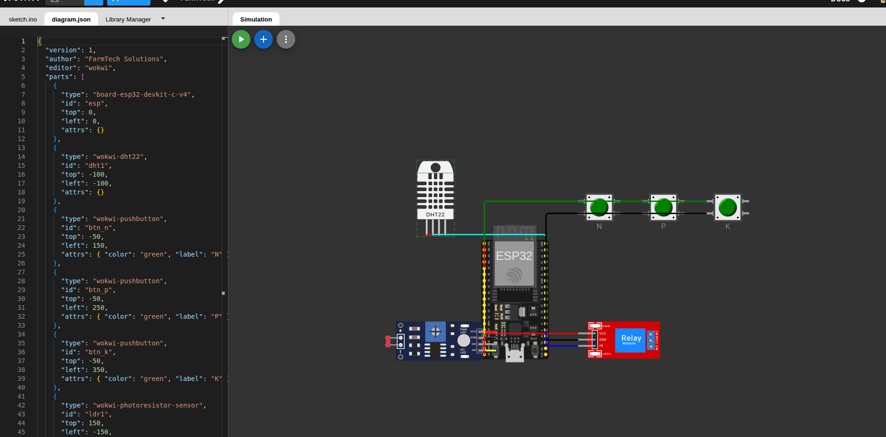

# FarmTech Solutions - Ecossistema AgroSaaS (FIAP)

**[LINK DO REPOSITORIO GITHUB]:** [https://github.com/angelosfreddo/agrosaas](https://github.com/angelosfreddo/agrosaas)

Repositorio central de desenvolvimento da **FarmTech Solutions**, contemplando as entregas de Agricultura Digital desenvolvidas para os modulos da FIAP (Turma 1TIAO).

---

## Estrutura do Repositorio

```
agrosaas/
├── .agents/
│   └── AGENTS.md                                      # Memoria do projeto e diretrizes de desenvolvimento
├── 1TIAO/
│   ├── FASE1/                                         # Fase 1: Gestao de Manejo, Calculo de Areas e Estatistica
│   │   ├── docs/                                      # Resumo cientifico da Embrapa (PDF, ODT, HTML, MD) e roteiro
│   │   ├── src/
│   │   │   ├── python/main.py                         # Aplicacao CRUD via terminal em vetores paralelos (Cafe e Milho)
│   │   │   └── r/
│   │   │       ├── analysis.R                         # Analise estatistica basica (Media, Desvio Padrao, Mediana)
│   │   │       └── weather.R                          # Integracao com a API publica Open-Meteo
│   │   ├── data/dados_fazenda.csv                     # Dataset compartilhado entre Python e R
│   │   └── link_video.txt                             # Link do video demonstrativo da Fase 1 no YouTube
│   └── FASE2/                                         # Fase 2: IoT, Irrigacao Inteligente e Gestao Agricola
│       ├── CAP1-UM-MAPA-DO-TESOURO/                   # Cap 1: Sistema IoT de Irrigacao e Fertirrigacao (ESP32, Python, R)
│       │   ├── src/
│       │   │   ├── iot_esp32/
│       │   │   │   ├── diagram.json                   # Circuito e pinagem montados no simulador Wokwi
│       │   │   │   └── sketch.ino                     # Firmware em C/C++ para o ESP32
│       │   │   ├── api_clima/clima_api.py             # Integracao com Open-Meteo e comando Serial (Ir Alem 1)
│       │   │   └── data_analysis_r/analise_irrigacao.R # Analise estatistica e preditiva em R (Ir Alem 2)
│       │   ├── docs/
│       │   │   ├── circuito_wokwi.png                 # Imagem do circuito montado no Wokwi
│       │   │   └── roteiro_video.md                   # Roteiro passo a passo para o video demonstrativo
│       │   ├── link_video.txt                         # Link do video demonstrativo no YouTube
│       │   └── README.md                              # Documentacao detalhada do Capitulo 1
│       ├── CAP6-PYTHON-E-ALEM/                        # Cap 6: PerdaZero - Gestao de Perdas na Colheita e Oracle
│       │   ├── config/parametros.json                 # Parametros agronomicos e financeiros
│       │   ├── data/                                  # Base local JSON (Offline-First) e exemplos de coleta
│       │   ├── src/                                   # Modulos Python (main, calculos, banco_oracle, validacao)
│       │   ├── IR-ALEM/DIFERENCIAIS.txt               # Descricao dos diferenciais implementados
│       │   └── README.md                              # Documentacao do sistema PerdaZero
│       ├── CAP7-DECOLANDO-COM-CIENCIA-DE-DADOS/       # Cap 7: Analise Estatistica Descritiva do Agronegocio
│       │   ├── analise_agronegocio.R                  # Script R completo com estatisticas e graficos
│       │   ├── base_dados_agronegocio.xlsx            # Base oficial Excel (36 linhas e 4 tipologias)
│       │   ├── base_dados_agronegocio.csv             # Base de dados em CSV
│       │   ├── grafico_1_quantitativa_produtividade.png # Histograma e Boxplot
│       │   ├── grafico_2_qualitativa_regiao.png       # Barras e Setores
│       │   ├── grafico_3_qualitativa_ordinal_porte.png # Barras Ordinal
│       │   └── README.md                              # Documentacao metodologica e estatistica
│       ├── docs/
│       │   ├── circuito_wokwi.png                     # Imagem do circuito Wokwi
│       │   └── roteiro_video.md                       # Roteiro de gravacao do video da Fase 2
│       └── README.md                                  # Visao geral da Fase 2
│   └── FASE3/                                         # Fase 3: Banco de Dados Estruturado, Python Cientifico, NoSQL e IA
│       ├── CAP1-ETAPAS-DE-UMA-MAQUINA-AGRICOLA/       # Cap 1: Historico de Irrigacao, Pandas/NumPy, Oracle, ESP32 e MongoDB
│       │   ├── data/                                  # CSVs brutos (Wokwi), tratados, indicadores e bases das Fases 1 e 2
│       │   ├── docs/                                  # Graficos Matplotlib/Seaborn, evidencias SQL e roteiro de video
│       │   ├── notebooks/                             # Jupyter Notebook interativo da analise exploratoria
│       │   ├── src/                                   # Firmware ESP32 CSV, pipeline Python (Pandas/NumPy/Oracle) e scripts SQL
│       │   ├── IR-ALEM/                               # Ir Alem 1 (ESP32 otimizado + R) e Ir Alem 2 (MongoDB NoSQL)
│       │   ├── link_entrega_portal.txt                # Arquivo .txt para submissao no Portal do Aluno
│       │   └── README.md                              # Documentacao completa do Cap 1 (Fase 3)
│       ├── CAP11-MODELAGEM-IA-FARMTECH/               # Cap 11: Analise exploratoria e 5 modelos de ML (produtos_agricolas.csv)
│       │   ├── data/                                  # Base original produtos_agricolas.csv (2.200 amostras, 22 culturas)
│       │   ├── notebooks/                             # Jupyter Notebook executado com graficos e comparativo de 5 modelos
│       │   ├── src/                                   # Script orquestrador de geracao e execucao do notebook
│       │   ├── requirements.txt                       # Dependencias de Ciencia de Dados e Scikit-Learn
│       │   └── README.md                              # Documentacao tecnica da modelagem de IA
│       └── README.md                                  # Visao geral da Fase 3
└── README.md                                          # Documentacao unificada do repositorio
```

---

## Visao Geral dos Modulos

### Fase 1 (`1TIAO/FASE1`)
- **Culturas Atendidas:** Cafe (talhoes retangulares) e Milho (talhoes trapezoidais).
- **CRUD em Python:** Gerenciamento interativo de areas, dosagem e pulverizacao por ruas com armazenamento em vetores paralelos.
- **Estatistica Descritiva em R:** Analise quantitativa de areas e insumos.
- **Integracao Climatica:** Monitoramento de vento e temperatura via API Open-Meteo.
- **Formacao Social:** Resumo do artigo da Embrapa (CAP8) sobre transformacao digital no campo.

---

### Fase 2 - Cap 1: Um Mapa do Tesouro (`1TIAO/FASE2/CAP1-UM-MAPA-DO-TESOURO`)
- **Cultura Foco:** Milho (*Zea mays*), com parametros fundamentados em estudos da **Embrapa Milho e Sorgo**.
- **Prototipo IoT ESP32 (Wokwi):**
  - **Sensor DHT22 (Umidade do Solo):** Aciona a bomba com umidade < 40% e desliga com >= 60%.
  - **Botoes Verdes (NPK):** Simulam sensores de Nitrogenio, Fosforo e Potassio. Aciona automaticamente o modo de **FERTIRRIGACAO** se houver deficiencia nutricional.
  - **Sensor LDR (pH do Solo):** Mapeado na escala de 0 a 14. Alerta para necessidade de calagem caso saia da faixa ideal (6.0 a 7.0).
  - **Rele Azul (Bomba d'Agua):** Modulo atuador que controla o fluxo hidrico.
- **Ir Alem 1 (Python + API Open-Meteo):** Consulta de previsao de chuva em tempo real e comando Serial (`1` ou `0`) para suspensao preventiva da irrigacao.
- **Ir Alem 2 (Data Science em R):** Analise exploratoria de historico de 10 dias e media movel de 3 dias para prescricao automatica de irrigacao.
- **Video Demonstrativo (YouTube - Nao Listado):** [https://youtu.be/AVC19HA_oGU](https://youtu.be/AVC19HA_oGU)

#### Circuito no Wokwi:


Consulte a documentacao completa em [`1TIAO/FASE2/CAP1-UM-MAPA-DO-TESOURO/README.md`](./1TIAO/FASE2/CAP1-UM-MAPA-DO-TESOURO/README.md).


---

### Fase 2 - Cap 6: Python e Alem (`1TIAO/FASE2/CAP6-PYTHON-E-ALEM`)
- **Sistema PerdaZero:** Solucao para monitoramento e gestao inteligente de perdas na colheita mecanizada de cana-de-acucar.
- **Arquitetura Offline-First + Oracle DB:** Operacao local em JSON com sincronizacao automatica para o banco de dados Oracle da FIAP.

Consulte a documentacao completa em [`1TIAO/FASE2/CAP6-PYTHON-E-ALEM/README.md`](./1TIAO/FASE2/CAP6-PYTHON-E-ALEM/README.md).

---

### Fase 2 - Cap 7: Decolando com Ciencia de Dados (`1TIAO/FASE2/CAP7-DECOLANDO-COM-CIENCIA-DE-DADOS`)
- **Analise Estatistica de Dados do Agro:** Base estruturada em Excel com 36 observacoes e 4 tipologias de variaveis (CONAB, IBGE e MAPA).
- **Estatistica Descritiva em R:** Medidas de Tendencia Central, Dispersao, Separatrizes e visualizacoes graficas (Histograma, Boxplot, Barras e Pizza).

Consulte a documentacao completa em [`1TIAO/FASE2/CAP7-DECOLANDO-COM-CIENCIA-DE-DADOS/README.md`](./1TIAO/FASE2/CAP7-DECOLANDO-COM-CIENCIA-DE-DADOS/README.md).

---

### Fase 3 - Cap 1: Etapas de uma Maquina Agricola (`1TIAO/FASE3/CAP1-ETAPAS-DE-UMA-MAQUINA-AGRICOLA`)
- **Parte 1 (Coleta e Processamento Cientifico):** Exportacao das leituras do Monitor Serial do Wokwi (ESP32), serie historica de 4 meses (2.880 horas), limpeza de anomalias e reducao de ruido por media movel de 6h com Pandas e NumPy, calculo de indicadores hidricos e geracao de 4 paineis graficos com Matplotlib e Seaborn (incluindo mapa de calor da correlacao de Pearson).
- **Parte 2 (Oracle Database e Primeira Persistencia):** Mapeamento de 6 informacoes relevantes de gestao, modelagem e criacao de 4 tabelas (`FT3_MANEJO_CULTURA`, `FT3_LEITURA_SENSOR`, `FT3_ACIONAMENTO_BOMBA`, `FT3_AVALIACAO_FASE2`), carga repetivel sem duplicacao (`MERGE INTO`) integrando os dados das Fases 1, 2 e 3, e 6 consultas SQL analiticas.
- **Ir Alem 1 (ESP32 Eficiente):** Otimizacao de tipos de variaveis e memoria no firmware C/C++ (`uint8_t`, `uint16_t`, bitmask, ponto fixo em decimos e `PROGMEM`), reduzindo em 62,5% as variaveis do sketch e preservando 100% da logica em 784 cenarios testados, alem de analise estatistica complementar em R.
- **Ir Alem 2 (Leituras Brutas em Banco NoSQL):** Carga das 2.881 leituras brutas como documentos JSON no MongoDB via `pymongo`, execucao de 5 consultas/agregacoes NoSQL e comparacao pratica entre MongoDB e Oracle Database.

Consulte a documentacao completa em [`1TIAO/FASE3/CAP1-ETAPAS-DE-UMA-MAQUINA-AGRICOLA/README.md`](./1TIAO/FASE3/CAP1-ETAPAS-DE-UMA-MAQUINA-AGRICOLA/README.md) e os desafios extras em [`1TIAO/FASE3/CAP1-ETAPAS-DE-UMA-MAQUINA-AGRICOLA/IR-ALEM/README.md`](./1TIAO/FASE3/CAP1-ETAPAS-DE-UMA-MAQUINA-AGRICOLA/IR-ALEM/README.md).

---

### Fase 3 - Cap 11: Modelagem de IA da FarmTech Solutions (`1TIAO/FASE3/CAP11-MODELAGEM-IA-FARMTECH`)
- **Analise Exploratoria e Perfil Ideal:** Estudo completo de `produtos_agricolas.csv` (2.200 observacoes balanceadas entre 22 culturas e 7 variaveis edafoclimaticas), com seis graficos estatisticos e comparacao de Arroz (`rice`), Maca (`apple`) e Cafe (`coffee`) frente ao perfil medio geral.
- **Cinco Modelos Preditivos Comparados:** Pipeline em Scikit-Learn avaliado em validacao cruzada estratificada (5 folds) e conjunto de teste (440 amostras), destacando a **Floresta Aleatoria** com **99,55%** de acuracia no teste, seguida por SVM RBF (`98,41%`), Arvore de Decisao (`98,18%`), KNN (`97,95%`) e Regressao Logistica (`97,27%`).

Consulte a documentacao completa em [`1TIAO/FASE3/CAP11-MODELAGEM-IA-FARMTECH/README.md`](./1TIAO/FASE3/CAP11-MODELAGEM-IA-FARMTECH/README.md).
